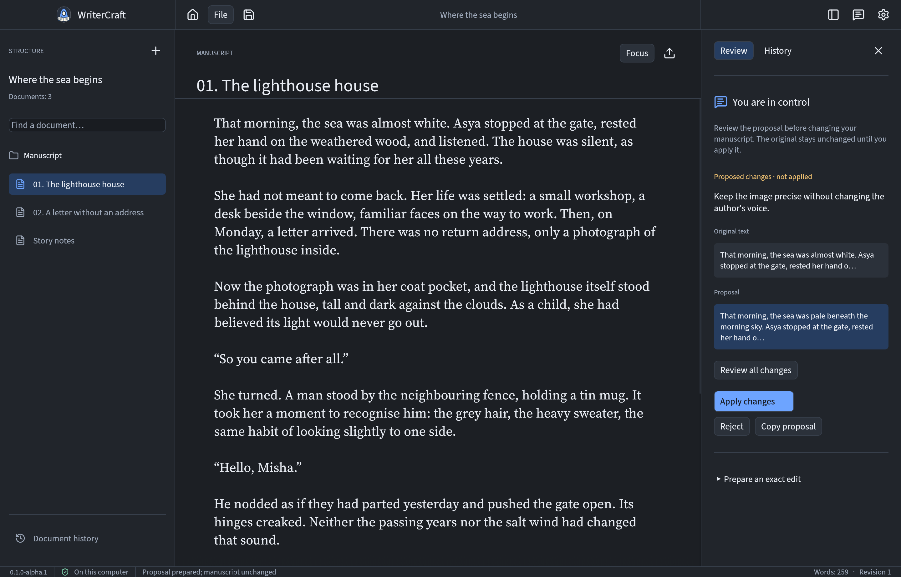
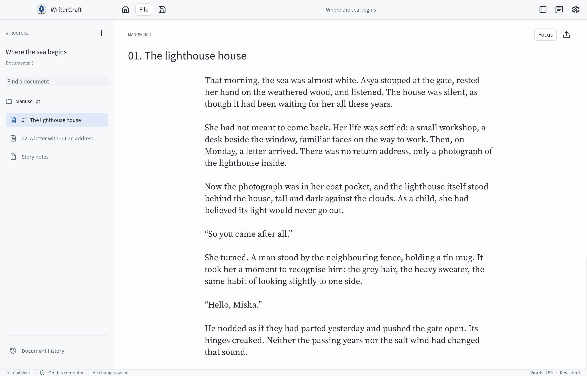

<p align="center">
  
</p>

<p align="center">
  <strong>A native, local-first workspace for long-form writing.</strong><br />
  Built in Rust. Open source. Your manuscript stays on your computer.
</p>

<p align="center">
  <a href="https://github.com/avacadorun-dev/writer-craft/actions/workflows/ci.yml">Preview builds</a> ·
  <a href="#what-works-today">Current scope</a> ·
  <a href="#run-from-source">Run from source</a> ·
  <a href="docs/migration/FEATURE_PARITY.md">Parity roadmap</a> ·
  <a href="docs/governance/RELEASING.md">Release policy</a>
</p>

> **Early alpha — engineering preview.** WriterCraft is becoming the native successor to Writers Studio. The current foundation supports plain prose and reviewed exact edits; it is not yet a complete replacement for the original product. Full workflow parity is the goal.

WriterCraft brings projects, a continuous manuscript, local history and reviewable changes into one desktop workspace. There is no browser interface, WebView, Docker container or server to operate. Everyday writing works without an account or an AI provider.

<table>
  <tr>
    <td width="50%"><br /><sub>Dark appearance · real application capture</sub></td>
    <td width="50%"><br /><sub>Light appearance · real application capture</sub></td>
  </tr>
</table>

## What works today

- **Local projects and prose.** A project library, document navigation, title search, text editing and plain-text export.
- **Writing with context.** A bounded, continuous manuscript pane with local scrolling, text selection and a focus mode.
- **Durable history.** SQLite storage, immutable revisions, autosave and recoverable working drafts. Revision checks prevent silent overwrites.
- **Review before change.** Prepare an exact edit, inspect it, then Apply or Reject. Guarded Undo preserves later work. This local utility does not pretend to be an AI model.
- **Safe archive inspection.** Check and preview `.wstudio` versions 1–8 without extracting files or changing the original. Rich JSON and the complete manifest remain intact.
- **Appearance and language.** Independent Light, Dark and System modes; six non-green legacy palettes plus the native blue palette. Eight built-in interface languages with CJK font coverage.
- **A shared core.** The desktop and headless CLI use the same domain commands and persistence rules.

The interface includes **Russian, English, German, French, Spanish, Portuguese, Simplified Chinese and Japanese**. Changing the interface language leaves your documents unchanged.

Rich-document editing, anchored notes and dictionary links, real AI providers, dictation and audio review, Canvas, complete project migration and publication exports remain on the [parity roadmap](docs/migration/FEATURE_PARITY.md). A text preview is not a migrated project, and an engineering test is not native UX acceptance.

## Get a preview

Pushes to `main` and manual dispatch run checks, then build **macOS, Windows and Linux engineering previews on GitHub**. Open a completed [Verify WriterCraft run](https://github.com/avacadorun-dev/writer-craft/actions/workflows/ci.yml) and download the artifact for your computer:

| Build target | Artifact suffix | Inside |
| --- | --- | --- |
| macOS, Apple silicon | `macos-arm64-preview` | ZIP with `WriterCraft.app` |
| Windows, x64 | `windows-x64-preview` | ZIP with `WriterCraft.exe` and notices |
| Linux, x64 | `linux-x64-preview` | tar.gz with an executable and notices; built on Ubuntu 24.04 |

Each artifact includes SHA-256 checksums, build/source evidence and an engineering-preview notice. Check the actual run result; defining a workflow does not mean a hosted build passed. Extract the archive before starting the application. The Linux archive requires a compatible desktop, GNU libc and X11/Wayland/GPU runtime libraries; it is not a universal AppImage. These portable archives are not installers.

The macOS app uses ad-hoc signing. Windows/Linux previews are unsigned. Developer ID notarization, platform UX qualification and automatic updates are separate work. A compiled artifact does not establish independent interaction acceptance or full workflow parity on that platform. Tagged macOS candidates can produce a **draft prerelease** after independent UX acceptance; stable releases are not published automatically. See [release and verification policy](docs/governance/RELEASING.md).

## Run from source

Use Rust **1.97 or newer** and your platform build tools (Xcode command-line tools on macOS, Visual Studio C++ build tools on Windows). On Debian/Ubuntu, install the [eframe native dependencies](https://github.com/emilk/egui/blob/49682f8baa058bf49e011035cfbd6e825f88a5ef/crates/eframe/README.md) plus `pkg-config`, `libwayland-dev` and `libx11-dev`; the hosted Linux build lists its exact packages in CI. End users downloading a built app do not need Rust.

```sh
cargo run --locked -p studio-desktop
```

Try the example in an isolated workspace:

```sh
cargo run --locked -p studio-desktop --   --database /tmp/writercraft-preview/workspace.sqlite --demo
```

The usual macOS workspace is `~/Library/Application Support/WriterCraft/`. Appearance and interface preferences live alongside its SQLite database.

| Shortcut | Action |
| --- | --- |
| `⌘S` | Save |
| `⌘N` | New project |
| `⌘O` | Preview a `.wstudio` archive |
| `⌘⇧A` | Toggle review |
| `⌘⇧F` | Toggle focus mode |
| `⌘,` | Settings |

For a local debug bundle, use `./scripts/package-macos.sh --debug`. Its default output is `artifacts/debug/WriterCraft.app`. Optimized distribution builds run on GitHub; the macOS and portable packaging scripts refuse accidental local release builds. Windows/Linux packaging uses `python scripts/package-portable.py --target <target-triple>` inside the hosted job. Its archive/header/checksum tests can run locally with `python3 scripts/package-portable.py --self-test` without compiling a release.

## Headless tools

```sh
cargo run --locked -p studio-cli -- demo --database /tmp/writercraft-demo.sqlite
cargo run --locked -p studio-cli -- list --database /tmp/writercraft-demo.sqlite
cargo run --locked -p studio-cli -- verify --database /tmp/writercraft-demo.sqlite
cargo run --locked -p studio-cli -- inspect project.wstudio
```

`inspect` is read only. `verify` checks readable core state and revision consistency; it is not a full filesystem, SQLite or migration audit.

## Build with evidence

```sh
./scripts/check.sh
python3 scripts/release-check.py --mode source
```

Changes follow [OpenSpec](docs/governance/SPEC_WORKFLOW.md), architecture decisions and an [independent desktop UX gate](docs/design/UX_ACCEPTANCE.md). The [feedback log](docs/design/USER_FEEDBACK.md) records owner corrections and the regression checks they require. Review findings stay open until retested; screenshots and catalog coverage do not establish complete interaction parity.

Start with [CONTRIBUTING.md](CONTRIBUTING.md), [AGENTS.md](AGENTS.md), the [PRD](docs/PRD.md), [architecture decisions](docs/architecture/DECISIONS.md) and [OpenSpec validation evidence](docs/governance/OPENSPEC_VALIDATION.md). Research covers [Artcraft](docs/research/ARTCRAFT.md), [TypeScript-to-Rust options](docs/research/TS_TO_RUST.md) and the [editor-model spike](docs/research/EDITOR_SPIKE.md).

| Crate | Responsibility |
| --- | --- |
| `studio-core` | Domain commands, revisions, proposals and local persistence |
| `studio-transfer` | Bounded, non-destructive archive inspection |
| `studio-desktop` | Native application and localized interaction |
| `studio-cli` | Headless access to the shared core |

WriterCraft stays focused on author workflows. A substantial reusable editor or rendering engine may become a separately versioned library after its scope is validated; it will not be silently vendored as a whole application.

## License and credits

WriterCraft uses the repository's [Apache License 2.0](LICENSE). Bundled Adobe Source and Noto fonts retain their own OFL notices in [assets/fonts](assets/fonts). Lucide utility icons retain their [upstream license and pinned provenance](assets/icons/lucide/NOTICE.md). Repo-local agent skills preserve their upstream licenses and provenance. Artcraft informed the architecture research; its application source and branding are not copied into this foundation.
