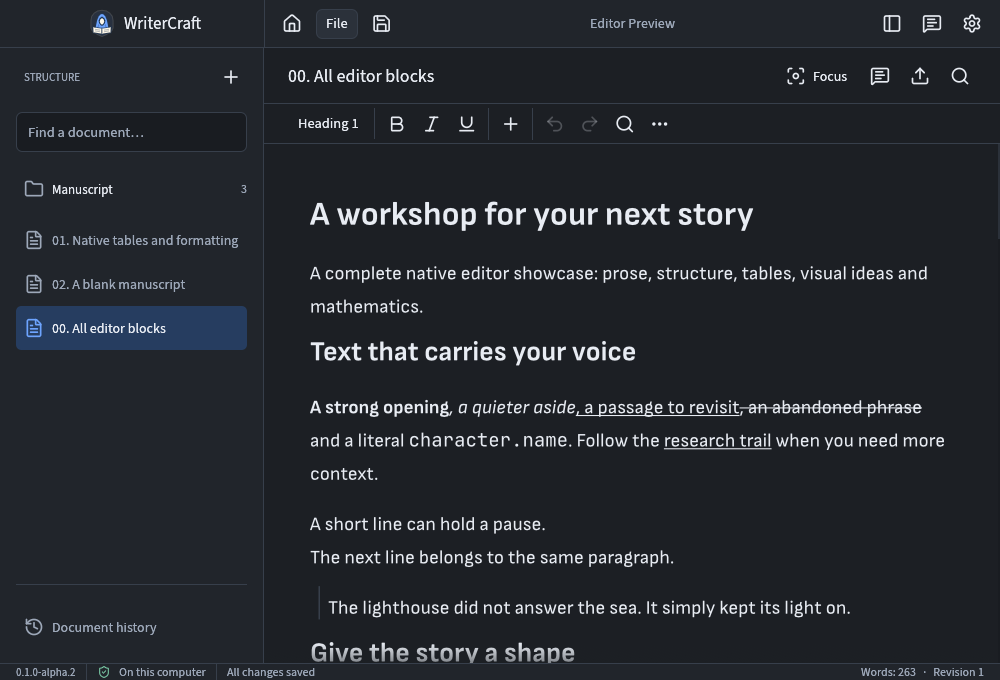
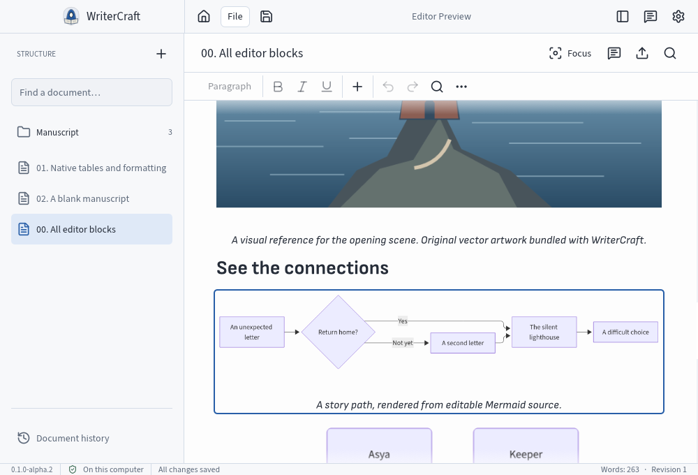
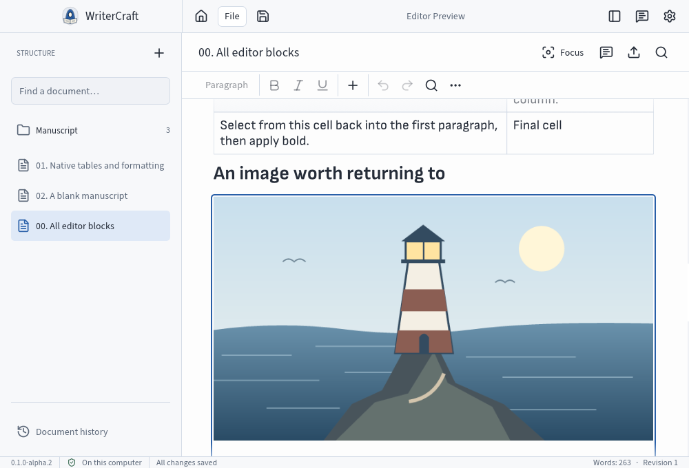
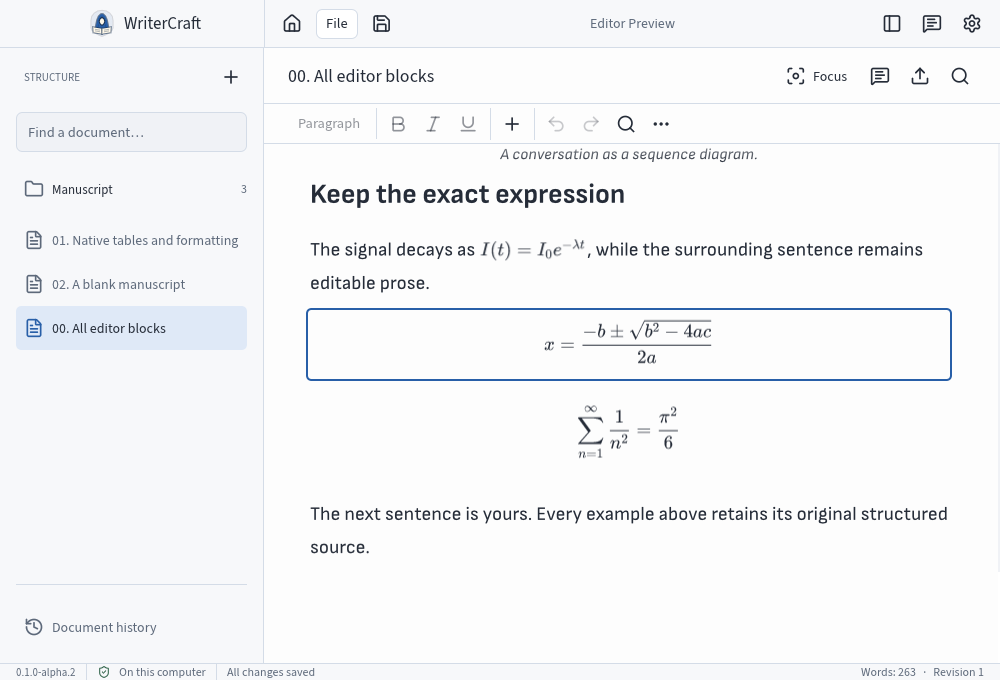
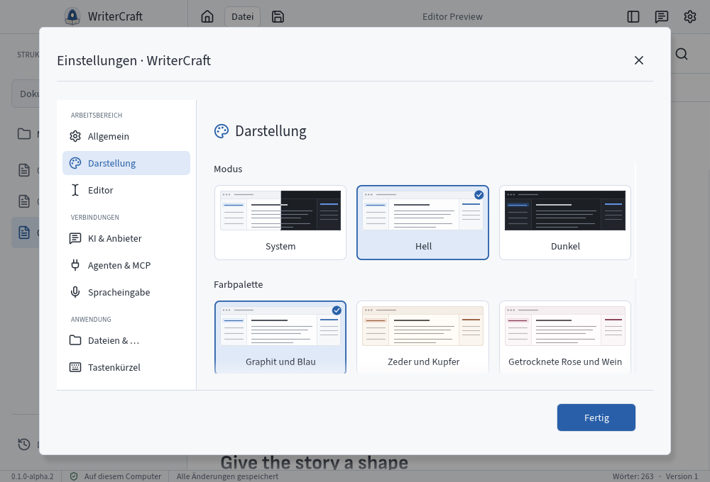

<p align="center">
  
</p>

<p align="center">
  <strong>A native, local-first workspace for long-form writing.</strong><br />
  Built in Rust. Open source. Your manuscript stays on your computer.
</p>

<p align="center">
  <a href="https://github.com/avacadorun-dev/writer-craft/releases/tag/v0.1.0-alpha.2">Download alpha.2</a> ·
  <a href="#the-workspace">Screenshots</a> ·
  <a href="#what-works-today">Current scope</a> ·
  <a href="#run-from-source">Build</a> ·
  <a href="https://github.com/avacadorun-dev/writer-craft/milestone/2">Alpha.3</a>
</p>

> **Alpha.2 — native rich-editor preview.** A working checkpoint of the native successor to Writers Studio. Complete original-product parity continues in alpha.3. See [known limits](#what-comes-next) before using it for important work.

Write in a continuous, bounded manuscript, organize local documents, work with structured blocks and keep revisioned drafts on your computer. No browser, WebView, Docker container, server or account is needed for local writing.

## Download and install

| Platform | Download | Install |
|---|---|---|
| **macOS 14+, Apple silicon** | [DMG image](https://github.com/avacadorun-dev/writer-craft/releases/download/v0.1.0-alpha.2/WriterCraft-0.1.0-alpha.2-macos-arm64.dmg) | Open the image and drag **WriterCraft** into **Applications** |
| **Windows x64** | [Setup executable](https://github.com/avacadorun-dev/writer-craft/releases/download/v0.1.0-alpha.2/WriterCraft-0.1.0-alpha.2-windows-x64-setup.exe) | Run the per-user installer |
| **Debian 12 / Ubuntu 24.04, amd64** | [Debian package](https://github.com/avacadorun-dev/writer-craft/releases/download/v0.1.0-alpha.2/WriterCraft-0.1.0-alpha.2-linux-amd64.deb) | `sudo apt install ./WriterCraft-0.1.0-alpha.2-linux-amd64.deb` |

[Release notes and checksums](https://github.com/avacadorun-dev/writer-craft/releases/tag/v0.1.0-alpha.2) · [Installation, removal and data locations](docs/distribution/INSTALL.md)

The macOS app is ad-hoc signed and **not notarized**; Windows packages are unsigned. These systems may show a first-launch security warning. macOS is the primary desktop target; Windows/Linux have hosted installation/removal checks, with full native interaction qualification still pending. There is no Intel Mac package or universal Linux AppImage in this release. Uninstalling the program preserves workspace data.

## The workspace

The following are historical **alpha.2** macOS captures with synthetic demo content. They show the released version, including its former monk identity; alpha.3 introduces the lion writer shown above. These are application screenshots, not design mockups.

<p align="center">
  
  <sub>A bounded manuscript and a compact, reachable formatting toolbar.</sub>
</p>

<table>
  <tr>
    <td width="50%"><br /><sub>Mermaid rendered in the document</sub></td>
    <td width="50%"><br /><sub>Local images and measured caption flow</sub></td>
  </tr>
  <tr>
    <td width="50%"><br /><sub>Inline and display formulas</sub></td>
    <td width="50%"><br /><sub>Native preferences and palette previews</sub></td>
  </tr>
</table>

## What works today

- **Native rich writing.** Formatting, headings, lists, tables and the currently integrated block insertion/property dialogs; local image assets, Mermaid, inline/display formulas, code with syntax decoration and callouts.
- **A deliberate writing surface.** Continuous local scrolling, bounded text measure, Focus, adaptive document presentation and configurable font, line height and spacing.
- **Local persistence.** SQLite workspaces, immutable revisions, autosave and recoverable rich drafts. Revision checks protect later work from stale edits. Current passage-note support is included; its complete legacy lifecycle remains in progress.
- **Appearance and language.** Russian, English, German, French, Spanish, Portuguese, Simplified Chinese and Japanese. Independent Light/Dark/System modes and seven non-green palettes and Lucide controls. The new lion-writer identity is part of alpha.3 development.
- **Acknowledged preferences.** Invalid or externally changed files are preserved. Unsaved choices remain explicitly session-only, with Retry and scoped Reload.
- **Transparent local storage.** Data-location and backup controls, archive inspection, and shared persistence/transfer foundations for the continuing migration.
- **Reviewable changes.** The existing exact-text proposal utility uses explicit Apply/Reject and guarded Undo. Live providers and the complete rich-assistant workflow remain unfinished.

Interface language and appearance changes leave manuscript content unchanged. Bundled fonts provide offline Latin and CJK coverage.

## What comes next

[Alpha.3](docs/governance/NEXT_RELEASE.md) carries the remaining complete table/clipboard/input behavior, note/dictionary/source links, genuine assistant selection and rich proposal integration, full `.wstudio` import/tree/history UI, native Canvas, PDF/audio/video, Markdown/artifact export UI, canonical restore and the remaining IME/accessibility/performance matrix.

Alpha.2 does **not** claim complete Writers Studio parity, completed Canvas/media migration, universal archive compatibility in the native UI, configured MCP/AI providers or daily-use certification. A preservation API or a rendered example is not a completed end-user workflow. Original parity requirements stay tracked in [GitHub issues](https://github.com/avacadorun-dev/writer-craft/issues) and the [migration inventory](docs/migration/EDITOR_PARITY_MATRIX.md).

## Your data

The normal application uses:

| System | Default workspace directory |
|---|---|
| macOS | `~/Library/Application Support/WriterCraft/` |
| Windows | `%APPDATA%\WriterCraft\` |
| Linux | `$XDG_DATA_HOME/WriterCraft/`, or `~/.local/share/WriterCraft/` |

`workspace.sqlite` contains local writing state; appearance, interface and editor preferences live beside it. Use the app's backup controls for a consistent workspace backup. An explicitly chosen custom database stays at its selected path. Isolated engineering previews use a separate workspace. Original source archives and manuscripts are never public CI fixtures.

## Run from source

Use Rust **1.97+** and your platform's native development tools. macOS needs Xcode command-line tools; Windows needs the Visual Studio C++ toolchain. Debian/Ubuntu dependencies are listed in the [hosted installer workflow](.github/workflows/distribution-alpha2.yml). Downloaded packages do not require Rust or Docker.

```sh
cargo run --locked -p studio-desktop --features editor-preview
```

The `editor-preview` Cargo feature enables the native rich editor. It uses the normal app identity unless the isolated preview is explicitly requested. For a disposable demo workspace:

```sh
cargo run --locked -p studio-desktop --features editor-preview -- \
  --database /tmp/writercraft-demo/workspace.sqlite --demo
```

Optimized installers build on GitHub. Local packaging defaults to debug; release scripts refuse accidental local optimized builds.

## Architecture and contribution

| Component | Responsibility |
|---|---|
| `studio-core` | Domain commands, revisions, draft/proposal guards and local persistence |
| `studio-transfer` | Bounded archive inspection, validation and transfer preparation |
| `studio-desktop` | Native application and localized interaction |
| `studio-cli` | Headless access to shared core commands |
| [CraftEditor](https://github.com/avacadorun-dev/craft-editor) | Separately versioned generic rich-editor/rendering engine |
| [CraftCanvas](https://github.com/avacadorun-dev/craft-canvas) | Separate native Canvas foundation; integration continues in alpha.3 |

Start with [CONTRIBUTING.md](CONTRIBUTING.md), [AGENTS.md](AGENTS.md), the [PRD](docs/PRD.md) and [architecture decisions](docs/architecture/DECISIONS.md). Development uses [OpenSpec](docs/governance/SPEC_WORKFLOW.md), source-backed parity contracts, exact-source hosted verification and [independent UX review](docs/design/UX_ACCEPTANCE.md). Owner-reported findings stay in GitHub issues until verified and accepted. See [release policy](docs/governance/RELEASING.md).

## License and credits

[MIT](LICENSE). Distributions retain Rust dependency notices and the licenses of [bundled fonts](assets/fonts) and [Lucide icons](assets/icons/lucide/NOTICE.md). Repo-local agent skills retain their own provenance. Artcraft informed the research; its application branding and source are not copied wholesale into WriterCraft.
