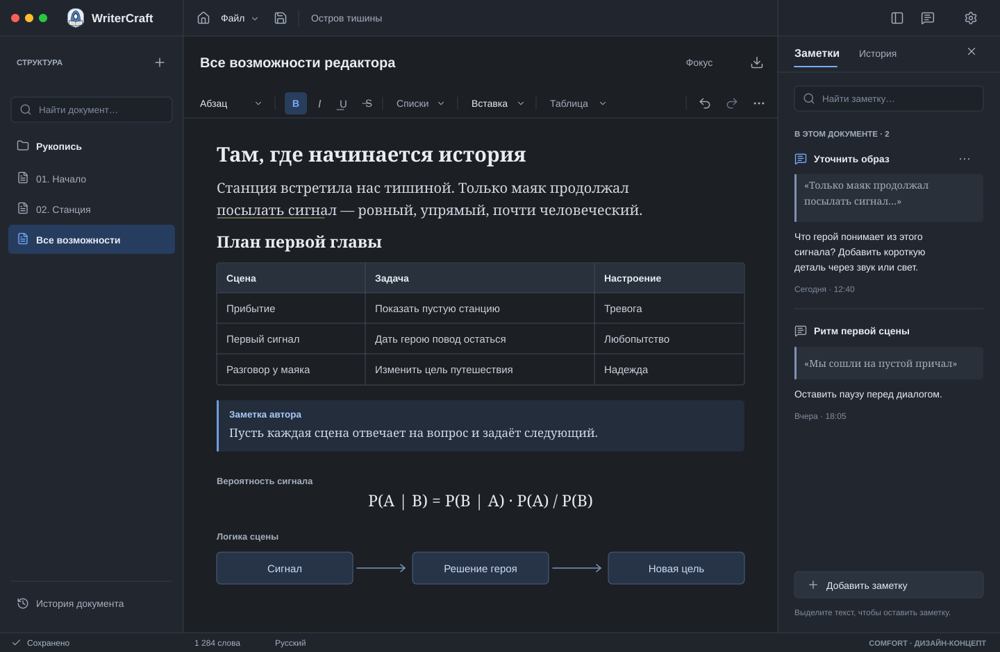
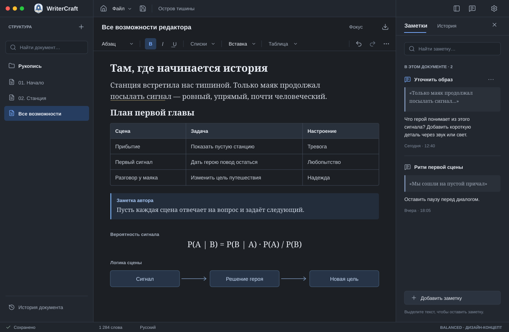

# Editor workspace concepts: Comfort and Balanced

Status: **Balanced selected by the owner for implementation**, 2026-11-08. This is the independent designer's response to [owner finding #6](https://github.com/avacadorun-dev/writer-craft/issues/6) and F-31. The owner explicitly chose Balanced after viewing the concept PNG. This approves the design direction and geometry for implementation, not native UX acceptance or issue closure.

The owner rejected excessive empty space above the manuscript and the current formatting strip, then clarified that the workspace must retain visual air and avoid cramming controls together. The finished concepts were presented before implementation; the owner chose **Balanced**. Implement its 48 px global bar, 56 px document identity, 40 px flat formatting row and 28 px initial manuscript gutter, with a 264 px default navigator and the same comfortable control/body spacing shown. Preserve the existing pane resize and compact-visibility behavior.

Both illustrations are **nonfunctional SVG design concepts, not native application captures**. They use the same 1440 × 940 logical viewport, 264 px navigator, 320 px Notes inspector, synthetic Russian document content, existing monk/book identity, pinned official Lucide geometry and current Dark/native-blue theme roles. The Notes inspector illustrates the already-required legacy annotations workflow; it does not assert that it is implemented. Drawn table, callout, formula and diagram content communicates layout only; it is not proof of renderer behavior. Image evidence for the actual renderer must come from a compiled app.

## Comparison and decision boundary

| Dimension | Comfort | Balanced |
|---|---|---|
| Global command bar | 52 px | 48 px |
| Document identity | 76 px | 56 px |
| Flat formatting row | 42 px | 40 px |
| Fixed top composition | 170 px | 144 px |
| Initial manuscript gutter | 32 px | 28 px |
| Document title | 20 px semibold | 18 px semibold |
| Manuscript type and line spacing | Same comfortable type/measure | Same comfortable type/measure |
| Navigator rows | 44 px | 44 px |
| Sidebar/inspector width and content | Identical | Identical |
| Character | More generous identity, clear pauses between zones | More writing space, restrained chrome without compressed prose |

The current implementation consumes 202 px in fixed top bars (48 + 110 + 44), followed by a 24 px manuscript gutter. Comfort changes that combined pre-content area from 226 to 202 px; Balanced changes it to 172 px. These are design geometry calculations, not measured compiled results. Neither option tries to maximize density. Both retain substantial manuscript margins, readable 20 px body text, comfortable block separation and 42–44 px navigation rows.

The designer recommended Balanced because it removes redundant hero spacing while keeping separate identity and formatting rows; the owner then explicitly selected it. Comfort remains a comparison artifact, not a second layout requirement. Do not implement both or introduce another preference solely because two concepts are shown. A focus-only layout was omitted so pane visibility did not bias the perceived space. The approved concept was shown as a nonfunctional PNG at an external temporary path; it is not native evidence.

## Shared composition

Preserve the accepted single-window shell and bounded continuous manuscript, native macOS traffic-light exclusion region, compact monk/name group and selected Lucide family. Keep navigator, identity, format row, inspector and status fixed while only manuscript content scrolls. Page layout belongs to publication, not the writing view.

The document identity uses one bounded title and existing Focus/Export actions, all vertically centered. Remove the redundant MANUSCRIPT eyebrow and repeated project title. Global project identity remains in its established position. Long titles truncate inside a known allocation and retain a full-value tooltip; they never overlap independent utility targets.

Formatting is an uninterrupted editor surface with a single subtle bottom divider. No rounded outer card, raised shadow or full outline surrounds it. Idle buttons are visually quiet; hover/focus/active states are clear. Individual controls retain at least 32 px hit targets. Use 18–20 px Lucide icons, 8 px icon-to-label gaps, 14 px UI command labels and normal breathing room between semantic groups. Body font preferences change prose, not chrome geometry.

Derive document/header/format boundaries from the same live pane rectangles as navigator and inspector. A fixed decorative padding cannot substitute for the shared vertical boundary. Use current semantic theme tokens, the 4/8/12/16/24 spacing scale and existing Source Sans/Source Serif roles. The 28/32 px manuscript inset is a deliberate document gutter, not a new spacing system.

Navigator category headings and rows follow the same leading grid: 16–24 px pane inset as appropriate to the existing control, 20 px icon box and 8 px label gap. Headings are left aligned, never centered. Group spacing remains deliberate and airy; rows do not expand to fill unused pane height. A compact title does not justify narrowing search fields, reducing type or placing tiny adjacent buttons.

Save/error/recovery status and counts stay in the established footer. Engineering build or preview identity belongs in status/About, not in the middle of formatting. The design-concept watermark in the illustrations is disclosure for review and is not a proposed product control.

## Formatting and contextual behavior

Use stable semantic groups: Paragraph/Heading; common marks; lists/quote; Insert; current Table context; Undo/Redo; grouped More formatting. The diagrams show one possible width allocation, not an instruction to hardcode text positions. Selection and pending typing marks are the source of truth for real active/mixed states. A mixed selection must not masquerade as fully enabled Bold or a single paragraph style.

Pointer and keyboard commands share the same path and preserve the semantic selection. Menus cancel without retargeting the caret. All supported heading levels, marks and transforms remain available. Block-specific source editors are bounded, contextual surfaces with explicit commit/cancel behavior. They do not create another permanent bar above the manuscript.

Insert exposes table, code language, image, Mermaid, inline/block formula, callout kinds and distinct separators with explicit names. The current table menu identifies its cell/range and provides actual available row/column/merge/split actions. Structural edits preserve a visible valid caret and coherent Undo/Redo. Capacity/stale failures explain their cause before mutation.

Keep the existing Auto/Expanded/Compact presentation choices. Measure translated widths and move secondary groups into labelled menus before the row runs out of space. At a 480–599 px central pane, retain style, common marks, Insert and More; table context and Undo/Redo remain reachable in named groups and conventional keyboard paths. At wider widths show context and secondary commands when they fit. Expanded must use overflow at insufficient width rather than clipping.

The row never wraps, scrolls horizontally or becomes taller. Moving a command into overflow does not remove its capability. Keep comfortable group gaps rather than shrinking every control to squeeze an extra group into a narrow row.

## Responsive and theme review

Use 1440 × 940 and 1000 × 680 actual client sizes. At minimum width, retain the existing rule that navigator or requested inspector yields before the manuscript falls below 480 px. Do not squeeze three unusable panes together. Verify navigator resize extremes, inspector widths and a visible Focus exit. Document title allocation shrinks before command targets do.

Support all eight existing languages and independent Light/Dark/System plus seven palettes. Measure actual long German/French labels and CJK titles; do not infer fit from English text or catalog completeness. Manuscript scaling and locale/theme changes preserve draft, semantic range, marks, Undo and focus.

The concepts show ordinary synthetic prose and related blocks with deliberate air. Final spacing must also work with short documents, long wrapping prose, large headings, tables, real image/caption, callouts and formula/diagram previews. Do not add blank canonical paragraphs to imitate design spacing.

## Complete interactive demonstration

The owner requires an actual interactive specimen covering all 21 canonical node types and six marks from [EDITOR_UX_PARITY.md](EDITOR_UX_PARITY.md), with real image bytes, rendered Mermaid and inline/block formulas. Structural nodes such as row/cell/listItem/text/hardBreak belong inside valid editable examples rather than artificial standalone samples.

Use known-good synthetic content covering heading levels, paragraph/quote, both lists, distinct separators, language-decorated code, a wrapped/spanned table, image alt/caption, Mermaid, all callout kinds, inline/block math and combined mark/link cases. Real editing, selection, insertion and Save/reopen are required. A source string, debug JSON, empty frame, colored placeholder or unsupported-block message does not demonstrate its corresponding feature.

The concepts are not that demo. Their diagrams, formulas and notes are illustrative design content. Full demo implementation and native review remain with the existing editor workstreams. Do not mutate owner projects or use illustrations as renderer acceptance.

## Regression checks after selection and implementation

| Check | Required evidence |
|---|---|
| Owner choice | Completed: the owner explicitly selected Balanced before host layout changes. Implement its named geometry; preserve this decision separately from pending native acceptance. |
| Vertical rhythm | Same-size actual rebuilt frame with measured global/identity/format rectangles and initial content origin matching the selected option. No hero-sized blank zone, cramped controls or compensating blank content. |
| Pane geometry | 1440 × 940 and 1000 × 680; navigator shown/hidden/resized; inspector requested/shown and Focus exit. Shared boundaries stay collinear and every action has an independent reachable target. |
| Format interaction | Pointer and keyboard across normal/reverse/mixed/cross-cell selections; open/cancel contextual and overflow menus. Exact selection, pending marks, caret, focus and Undo survive. Active/mixed/disabled states report real state. |
| Content and air | Compare the same meaningful manuscript in both pane configurations. Comfortable body measure/line spacing and distinct block separation remain. No whole-editor horizontal scroll or toolbar wrap. |
| Language and appearance | Inspect long German/French and CJK labels, all eight language switches, Light/Dark and representative independent palettes. Existing token checks cover all palette/mode combinations; native focus/selection contrast still requires observation. |
| Full specimen | Actual 21-node/six-mark document with operational image/diagram/math and other blocks, selection/editing/context/Save/reopen/recovery. Record failures honestly; do not replace unimplemented blocks with a design picture. |
| Independent retest | Exact source/engine/build identity, retained native captures/hashes and interaction results. An SVG or source edit does not close #6/F-31 or pass the full-editor gate. |

Do not disturb the owner's open preview before handoff. No app source, issue closure or `UX_GATE.json` change is part of this design-only work.
